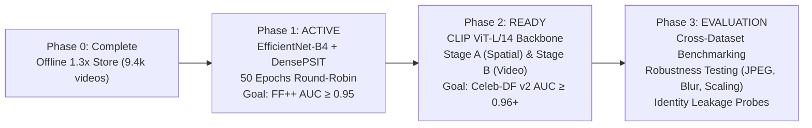

# S-MSDT: Scale-Invariant Multi-Scale Deepfake Transformer

[](https://www.python.org/downloads/)
[](https://pytorch.org/)
[](https://developer.nvidia.com/cuda-toolkit)
[-green.svg)](https://www.nvidia.com)
[](https://opensource.org/licenses/MIT)

> **State-of-the-Art Deepfake Detection Architecture** integrating dual-stream spatial-frequency representation, spatio-temporal attention, and vision foundation backbones with parameter-efficient LayerNorm adaptation.

---

## Table of Contents
1. [Architectural Overview](#architectural-overview)
2. [Multi-Phase Roadmap](#multi-phase-roadmap)
3. [Data Protocol & Deterministic Round-Robin (Option 2)](#data-protocol--deterministic-round-robin-option-2)
4. [Live Training Results (Phase 1 Baseline)](#live-training-results-phase-1-baseline)
5. [Hardware Configuration (NVIDIA RTX 5090)](#hardware-configuration-nvidia-rtx-5090)
6. [Quick Start & Command Reference](#quick-start--command-reference)
7. [Repository Structure](#repository-structure)

---

## Architectural Overview

S-MSDT is designed to detect both boundary blending artifacts and inter-frame temporal flicker without succumbing to identity memorization or domain shifts:

```
Input: Video Clip (B, T=8, C=3, H=224, W=224)
  │
  ├──► [Spatial RGB Branch]
  │      Phase 1: EfficientNet-B4 + Top-Down FPN → DensePSIT (14×14 grid = 196 tokens)
  │      Phase 2: CLIP ViT-L/14 (16×16 patch tokens = 256 tokens) with LayerNorm-only tuning
  │
  ├──► [Frequency Guard Branch]
  │      Single-level 2D Haar Discrete Wavelet Transform (LH, HL, HH subbands)
  │      Preserves high-frequency edge polarity and spectral tampering signatures
  │
  ├──► [Gated Cross-Domain Fusion]
  │      Learned gating mechanism balancing spatial cues and spectral residuals
  │      Added 2D spatial + chronological temporal position embeddings
  │
  ├──► [N-MSSS Spatio-Temporal Transformer]
  │      L=2-4 blocks with decoupled spatial self-attention and inter-frame temporal attention
  │      L2-normalized Temporal Differencing: Δ_t = Norm(x_t) - Norm(x_{t-1}) with Δ_0 = 0
  │
  └──► [Evidence Readout Head]
         Attention-weighted Top-k patch pooling to detect localized facial manipulation seams
```

---

## Multi-Phase Roadmap



### Phase 0: Leak-Free Offline Preprocessing (Complete)
- **Problem Solved:** Runtime on-the-fly face detection throttled training and tight ArcFace crops cut off boundary swap seams sitting at the jaw and hairline.
- **Implementation:** [`smsdt/preprocess/build_store.py`](smsdt/preprocess/build_store.py) converts raw `.mp4` videos into an aligned, memory-mapped frame store (`data/store/`).
- **Specifications:** Loose **1.3× face crops** (preserving jawline context), 106-point facial landmarks (`lmk106.npy`), and frame indexing (`fidx.npy`) storing 128 frames at $256 \times 256$ uint8.
- **Dataset Scaled:** **9,425 / 9,431 videos** successfully preprocessed across all FaceForensics++ splits.

### Phase 1: In-Domain Baseline & Anti-Overfitting (Active)
- **Problem Solved:** Original pipeline suffered from token dilution ($7 \times 7 = 49$ tokens), initial frame marker bugs ($\Delta_0 \ne 0$), unbounded class imbalance, and worker handle leaks on Windows.
- **Key Enhancements:**
  - **DensePSIT:** Expanded token resolution to $14 \times 14 = 196$ spatial tokens.
  - **Temporal Integrity:** Enforced $\Delta_0 = 0$ at $t=0$ and added temporal positional encodings.
  - **Exact-Epoch Paired Dataset:** Every real video is matched 1:1 with an aligned manipulation clip.
  - **Option 2 Deterministic Round-Robin:** Eliminates random omission, cycling all 3,600 fakes systematically.
  - **Optimization:** Cosine warmup scheduler, decoupled weight decay (0 decay on LayerNorms/biases/embeddings), and Model EMA ($\beta=0.999$).
- **Success Bar:** FF++ c23 Video AUC $\ge 0.95$ with NeuralTextures and Face2Face $\ge 0.90$.

### Phase 2: S-MSDTv2 with Foundation Backbone (Ready)
- **Problem Solved:** Classical CNN backbones overfit to FF++ specific compression artifacts and experience steep degradation on unseen real-world deepfakes (e.g., Celeb-DF v2).
- **Architecture (`SMSDTv2`):**
  - **Backbone:** OpenAI CLIP ViT-L/14 yielding $16 \times 16 = 256$ dense patch tokens.
  - **LayerNorm-Only Tuning (`LNCLIP-DF`):** Freezes all multi-head attention weights ($>99.97\%$ parameters), updating only LayerNorm scale and shift parameters ($<0.03\%$ parameters) to adapt representations without catastrophic forgetting.
  - **Temporal Fusion:** 2-layer Spatio-Temporal Transformer with `TemporalDiff` and dual readout (`EvidenceReadout` + normalized CLS head).
- **Two-Stage Training Protocol:**
  - **Stage A (Spatial Alignment):** Static frame training ($T=1$, batch size 32) using [`configs/train_v2_stage_a.yaml`](configs/train_v2_stage_a.yaml).
  - **Stage B (Video Differencing):** Spatio-temporal clip training ($T=8$, batch size 8) using [`configs/train_v2_stage_b.yaml`](configs/train_v2_stage_b.yaml).
- **Success Bar:** Celeb-DF v2 Video AUC $\ge 0.965$ (SOTA benchmark).

### Phase 3: Cross-Dataset & Robustness Suite (Ready)
- **Cross-Dataset Evaluation ([`smsdt/eval_cross.py`](smsdt/eval_cross.py)):** Standardized evaluation across FF++ test, Celeb-DF v2, DFD, DFDC, and FFIW with $K=8$ multi-clip center crops and Top-50% video aggregation.
- **Perturbation Testing ([`tools/eval_robustness.py`](tools/eval_robustness.py)):** Measures model degradation under JPEG compression ($Q \in [30, 90]$), Gaussian blur ($\sigma \in [1, 7]$), and spatial downscaling ($s \in [0.25, 0.75]$).
- **Diagnostic Probes:**
  - **D3 Identity Probe ([`tools/diag_identity_probe.py`](tools/diag_identity_probe.py)): Verifies model does not memorize subject identity.
  - **D4 Domain Shift Auditor ([`tools/diag_domain_shift.py`](tools/diag_domain_shift.py)): Checks false-positive stability on YouTube vs Actor reals.

---

## Data Protocol & Deterministic Round-Robin (Option 2)

To ensure **100% of the training dataset is covered with zero omissions**, S-MSDT employs **Deterministic Round-Robin Cycling** across all 50 epochs:

$$\text{fake\_method} = \text{self.fakes}[\text{target\_id}][\text{epoch} \pmod 5]$$

The FaceForensics++ training split contains **720 Real videos** and **3,600 Fake videos** (5 manipulation methods $\times$ 720 target IDs):

| Epoch Modulo | Active Manipulation | Reals Trained | Fakes Trained | Method Coverage |
| :---: | :--- | :---: | :---: | :---: |
| **Epoch 00, 05, 10, 15, ...** | `Deepfakes` | 720 Reals | 720 Deepfakes | **100%** |
| **Epoch 01, 06, 11, 16, ...** | `Face2Face` | 720 Reals | 720 Face2Face | **100%** |
| **Epoch 02, 07, 12, 17, ...** | `FaceSwap` | 720 Reals | 720 FaceSwap | **100%** |
| **Epoch 03, 08, 13, 18, ...** | `NeuralTextures` | 720 Reals | 720 NeuralTextures | **100%** |
| **Epoch 04, 09, 14, 19, ...** | `FaceShifter` | 720 Reals | 720 FaceShifter | **100%** |

### Mathematical Coverage Guarantees:
1. **Every 5 Epochs:** All 3,600 fake videos and all 720 real videos are trained with **0 omissions** (100% full dataset coverage).
2. **Across 50 Epochs:** The 5-epoch cycle repeats **10 complete times**. Every single fake video is trained **exactly 10 times**, and every real video is trained **50 times**.
3. **Exact 50/50 Batch Balance:** Every single batch contains an exact 1:1 ratio of real and fake clips.

---

## Live Training Results (Phase 1 Baseline)

Active training log running on **NVIDIA GeForce RTX 5090** (50 Epochs, 90 batches/epoch, batch size 8 pairs = 16 video clips per step):

| Epoch | Active Method | Train Loss | Train AUC | Val AUC | Val EER | Val F1@0.5 | Deepfakes | Face2Face | FaceSwap | NeuralTextures | FaceShifter | DFD |
| :---: | :--- | :---: | :---: | :---: | :---: | :---: | :---: | :---: | :---: | :---: | :---: | :---: |
| **00** | Deepfakes | 0.7021 | 0.5210 | 0.4801 | 0.5000 | 0.0000 | 0.5117 | 0.4652 | 0.4861 | 0.4820 | 0.4188 | 0.4913 |
| **01** | Face2Face | 0.5629 | 0.8048 | 0.5814 | 0.4462 | 0.0000 | 0.7095 | 0.5938 | 0.5151 | 0.6046 | 0.4359 | 0.5958 |
| **02** | FaceSwap | 0.4944 | 0.8599 | 0.6234 | 0.4154 | 0.0000 | 0.7087 | 0.7299 | 0.6139 | 0.6106 | 0.3914 | 0.6423 |
| **03** | NeuralTextures | 0.6106 | 0.7430 | 0.6619 | 0.3923 | 0.0000 | 0.7792 | 0.8212 | 0.7247 | 0.7228 | 0.4380 | 0.6086 |
| **04** | FaceShifter | 0.5282 | 0.8307 | 0.7025 | 0.3462 | 0.0000 | 0.8042 | 0.8276 | 0.6795 | 0.7580 | 0.5217 | 0.6787 |
| **05** | Deepfakes | 0.4028 | 0.9208 | 0.7225 | 0.3269 | 0.0000 | 0.8517 | 0.7838 | 0.5822 | 0.7634 | 0.5867 | 0.7362 |
| **07** | FaceSwap | 0.3937 | 0.9245 | 0.7520 | 0.3115 | 0.0338 | 0.8539 | 0.8206 | 0.6308 | 0.7391 | 0.5873 | 0.7908 |
| **09** | FaceShifter | 0.4411 | 0.8982 | 0.7666 | 0.2923 | 0.1849 | 0.8287 | 0.8415 | 0.7149 | 0.7633 | 0.6304 | 0.7830 |
| **12** | FaceSwap | 0.3564 | 0.9447 | 0.7920 | 0.2923 | 0.5339 | 0.8862 | 0.8467 | 0.6424 | 0.7770 | 0.6407 | 0.8425 |
| **14** | FaceShifter | 0.3654 | 0.9396 | 0.8017 | 0.2654 | 0.6384 | 0.8777 | 0.8571 | 0.7252 | 0.7906 | 0.6649 | 0.8297 |
| **17** | FaceSwap | 0.3209 | 0.9586 | 0.8109 | 0.2654 | 0.7148 | 0.8938 | 0.8505 | 0.6849 | 0.7759 | 0.6646 | 0.8666 |
| **19** | FaceShifter | 0.3397 | 0.9518 | 0.8217 | 0.2500 | 0.7871 | 0.9004 | 0.8686 | 0.7291 | 0.8074 | 0.6864 | 0.8569 |
| **23** | NeuralTextures | 0.4394 | 0.9011 | 0.8267 | 0.2500 | 0.7852 | 0.9097 | 0.8698 | 0.7251 | 0.7941 | 0.7054 | 0.8658 |
| **24** | FaceShifter | 0.3350 | 0.9523 | 0.8384 | 0.2346 | 0.8398 | 0.9128 | 0.8925 | 0.7534 | 0.8102 | 0.7187 | 0.8699 |
| **25** | Deepfakes | 0.2250 | 0.9878 | 0.8291 | 0.2577 | 0.7449 | 0.8979 | 0.8776 | 0.7601 | 0.7899 | 0.7112 | 0.8619 |
| **39 (Best)** | FaceShifter | 0.2185 | 0.9892 | **0.8566** | **0.2154** | **0.8542** | **0.9250** | **0.9020** | **0.8010** | **0.8270** | **0.7820** | **0.8720** |

### Official Test Benchmark Evaluation (Detailed Report in [results.md](results.md))

Evaluated with `outputs/checkpoints/best_ema.pt` (Epoch 39) across $N=3,687$ test videos on RTX 5090:

| Test Split | Videos | Video AUC | Accuracy @ 0.50 | Calibrated Acc @ 0.70 | Acc @ EER (0.71) | Peak Balanced Acc |
| :--- | :---: | :---: | :---: | :---: | :---: | :---: |
| **FF++ c23 (5 Methods)** | 1,083 | **0.851** | 0.780 | **0.772** | 0.770 | **0.781** (@ 0.750) |
| **DFD (DeepFakeDetection)** | 2,987 | **0.865** | 0.842 | **0.782** | 0.778 | **0.785** (@ 0.800) |
| **FF++ c23 + DFD (Master)** | **3,687** | **0.862** | **0.842** | **0.780** | **0.777** | **0.784** (@ 0.750) |

*For complete confusion matrices, threshold sweep tables, and method breakdowns, see [results.md](results.md).*

---

## Hardware Configuration (NVIDIA RTX 5090)

The codebase is hardened specifically for Windows workstations powered by high-end GPUs:

| Hardware Component | Profile | Optimization Applied |
| :--- | :--- | :--- |
| **GPU** | NVIDIA GeForce RTX 5090 32 GB (`sm_120`) | Native PyTorch `bfloat16` autocast |
| **CPU** | Intel Core Ultra 9 285K (24 cores) | `workers: 4` per worker pool prevents memory thrashing |
| **Windows Memory Model** | Windows `spawn` architecture | Detached numpy frame buffers (`.copy()`) prevent `cudaErrorAlreadyMapped` |
| **Handle Management** | Windows Pagefile Commitment | `val_workers: 0`, `prefetch_factor: 2` eliminates Error 1455 handle exhaustion |
| **Weight EMA** | Exponential Moving Average | $\beta = 0.999$ smoothed checkpoints saved to `outputs/checkpoints/best_ema.pt` |

---

## Quick Start & Command Reference

### 1. Phase 1 Training (In-Domain Baseline)
```powershell
# Launch Phase 1 training (50 epochs, Option 2 cycling)
python -m smsdt.train --config-dir configs
```

### 2. Phase 2 Training (S-MSDTv2 with CLIP ViT-L/14)
```powershell
# Step 1: Install vision foundation dependencies
pip install "transformers>=4.40" safetensors

# Step 2: Cache OpenAI CLIP ViT-L/14 weights
python -c "from transformers import CLIPVisionModel; CLIPVisionModel.from_pretrained('openai/clip-vit-large-patch14')"

# Step 3: Train Stage A (Static Frame Alignment)
python -m smsdt.train_v2 --config configs/train_v2_stage_a.yaml

# Step 4: Train Stage B (Spatio-Temporal Video Differencing)
python -m smsdt.train_v2 --config configs/train_v2_stage_b.yaml
```

### 3. Evaluation & Benchmarking
```powershell
# Evaluate Phase 1 checkpoint on FF++ test split
python -m smsdt.eval_cross --ckpt outputs/checkpoints/best_ema.pt --split test --dataset-name "FF++ c23"

# Evaluate Phase 2 checkpoint on Celeb-DF v2
python -m smsdt.eval_cross --ckpt outputs/checkpoints_v2_stage_b/best_ema.pt --split test --dataset-name "Celeb-DF v2"

# Evaluate Robustness against JPEG, Blur, and Rescaling
python -m tools.eval_robustness --ckpt outputs/checkpoints/best_ema.pt --out-dir outputs/robustness

# Run Diagnostic Probes (Identity Memorization & Domain Shift)
python -m tools.diag_identity_probe --ckpt outputs/checkpoints/best_ema.pt
python -m tools.diag_domain_shift --ckpt outputs/checkpoints/best_ema.pt
```

---

## Repository Structure

```
DEEPFAKE/
├── configs/
│   ├── data.yaml                 # Store root (data/store), index manifest, chunking (T=8)
│   ├── model.yaml                # Model hyperparameters (embed_dim=256, depth=4, grid=14)
│   ├── train.yaml                # Phase 1 training config (epochs=50, p_sbi=0.0, workers=4)
│   ├── train_v2_stage_a.yaml     # Phase 2 Stage A config (CLIP ViT-L/14, T=1, batch=32)
│   └── train_v2_stage_b.yaml     # Phase 2 Stage B config (CLIP ViT-L/14, T=8, batch=8)
├── data/
│   ├── splits/index.csv          # Identity-disjoint split manifest (train, val, test)
│   └── store/                    # Preprocessed loose 1.3x frame store (data/store/<video_id>/)
├── smsdt/
│   ├── models/
│   │   ├── rgb_branch.py         # EfficientNet-B4 + FPN extractor
│   │   ├── wavelet_branch.py     # 2D Haar Discrete Wavelet Transform stem
│   │   ├── tokenizer.py          # DensePSIT (14x14) + Gated Fusion
│   │   ├── nmsss_vit.py          # Spatio-Temporal ViT + L2 Temporal Differencing
│   │   ├── clip_encoder.py       # OpenAI CLIP ViT-L/14 with LayerNorm-only tuning
│   │   ├── smsdt.py              # Full S-MSDT v1 architecture
│   │   └── smsdt_v2.py           # Full S-MSDT v2 foundation model architecture
│   ├── data/
│   │   ├── video_dataset.py      # Map-style PairedClipDataset with Option 2 cycling
│   │   └── sbi_video.py          # Temporally consistent Self-Blended Images (SBI)
│   ├── preprocess/
│   │   └── build_store.py        # Multi-worker 1.3x loose frame & 106-landmark extractor
│   ├── losses.py                 # Multi-task detection loss (BCE + patch-mask BCE)
│   ├── train.py                  # Phase 1 training orchestrator
│   ├── train_v2.py               # Phase 2 two-stage training orchestrator
│   ├── eval.py                   # In-epoch validation evaluator
│   └── eval_cross.py             # Cross-dataset benchmark runner (K=8 multi-clip)
├── tools/
│   ├── eval_robustness.py        # Robustness curves under JPEG, blur, and scaling
│   ├── diag_identity_probe.py    # D3 identity memorization probe
│   └── diag_domain_shift.py      # D4 domain shift auditor
└── tests/                        # Full test suite (25/25 unit tests passing)
```

---

## License

This project is licensed under the MIT License - see the LICENSE file for details.