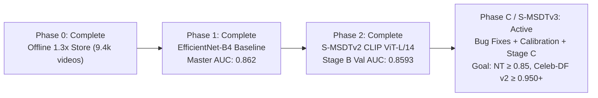

# S-MSDT: Scale-Invariant Multi-Scale Deepfake Transformer

[](https://www.python.org/downloads/)
[](https://pytorch.org/)
[](https://developer.nvidia.com/cuda-toolkit)
[-green.svg)](https://www.nvidia.com)
[](https://opensource.org/licenses/MIT)

> **State-of-the-Art Deepfake Detection Architecture** integrating dual-stream spatial-frequency representation, spatio-temporal attention, and vision foundation backbones with parameter-efficient LayerNorm adaptation.

---

## Table of Contents
1. [Architectural Overview](#architectural-overview)
2. [Multi-Phase Roadmap & Implementation Status Tracker](#multi-phase-roadmap--implementation-status-tracker)
3. [Data Protocol & Stateless Balanced Fake Sampling](#data-protocol--stateless-balanced-fake-sampling)
4. [Training Formulation, Two-Stage Progression & Loss Functions](#training-formulation-two-stage-progression--loss-functions)
5. [Scientific Evaluation, Calibration & Testing Protocol](#scientific-evaluation-calibration--testing-protocol)
6. [Live Training Results (Phase 1 Baseline)](#live-training-results-phase-1-baseline)
7. [Hardware Configuration (NVIDIA RTX 5090)](#hardware-configuration-nvidia-rtx-5090)
8. [Quick Start & Command Reference](#quick-start--command-reference)
9. [Repository Structure](#repository-structure)

---

## Architectural Overview

S-MSDT is designed to detect both boundary blending artifacts and inter-frame temporal flicker without succumbing to identity memorization or domain shifts:

```
Input: Video Clip (B, T=8, C=3, H=224, W=224)
  │
  ├──► [Spatial RGB Branch]
  │      Phase 1: EfficientNet-B4 + Top-Down FPN → DensePSIT (14×14 grid = 196 tokens)
  │      Phase 2: CLIP ViT-L/14 (16×16 patch tokens = 256 tokens) with LayerNorm-only tuning
  │
  ├──► [Frequency Guard Branch]
  │      Single-level 2D Haar Discrete Wavelet Transform (LH, HL, HH subbands)
  │      Preserves high-frequency edge polarity and spectral tampering signatures
  │
  ├──► [Gated Cross-Domain Fusion]
  │      Learned gating mechanism balancing spatial cues and spectral residuals
  │      Added 2D spatial + chronological temporal position embeddings
  │
  ├──► [N-MSSS Spatio-Temporal Transformer]
  │      L=2-4 blocks with decoupled spatial self-attention and inter-frame temporal attention
  │      L2-normalized Temporal Differencing: Δ_t = Norm(x_t) - Norm(x_{t-1}) with Δ_0 = 0
  │
  └──► [Evidence Readout Head]
         Attention-weighted Top-k patch pooling to detect localized facial manipulation seams
```

---

## Multi-Phase Roadmap & Implementation Status Tracker



### Master Implementation Status vs. Execution Roadmap

Following [`SOTA Roadmap`](docs/roadmap/SOTA_Roadmap.md), the codebase enforces a strict scientific discipline: **data pipeline and training defect fixes must be isolated and benchmarked first (Step 4) before introducing new neural network modules (Step 5)** to determine whether performance collapse on NeuralTextures and Face2Face was caused by worker starvation or model capacity.

| Step | Roadmap Component | Status | Codebase Modifications & Implementations |
| :---: | :--- | :---: | :--- |
| **1** | **D2 Worker Freeze Verification** | ✅ **Complete** | Confirmed that Windows multiprocessing with `persistent_workers: true` isolated worker dataset memory, freezing fake method rotation on Method 0 (`Deepfakes`). |
| **2** | **Hygiene Bug Fixes (D1, D2, D3)** | ✅ **Complete** | • **D1:** Added difference-derived manipulation masks $\|fake_{u8} - real_{u8}\|$ with $w_{\text{pos}}=3.0$ in [`video_dataset.py`](smsdt/data/video_dataset.py) & [`losses.py`](smsdt/losses.py).<br>• **D2:** Implemented worker-safe stateless balanced sampling `pick_fake` (25% NT, 25% F2F, 20% FS, 15% DF, 15% FSwap).<br>• **D3:** Added dynamic EMA warmup $d_t = \min(0.999, \frac{1+t}{10+t})$ in [`train_v2.py`](smsdt/train_v2.py).<br>• Excluded scalars (`beta`, `mix`, `p.ndim < 2`) from weight decay in [`smsdt_v2.py`](smsdt/models/smsdt_v2.py).<br>• Filtered 584 DFD videos from validation split (leaving 840 pure FF++ videos).<br>• Accelerated validation with `val_start_epoch: 10` (skips epochs 1–9, saves `last.pt` atomically). |
| **3** | **Scientific Testing & Calibration Engine** | ✅ **Complete** | Integrated directly into [`eval_cross.py`](smsdt/eval_cross.py) without repo clutter:<br>• Class-balanced Platt scaling (`fit_platt`) via L-BFGS.<br>• Optimal decision threshold search via Youden's $J = \text{TPR} - \text{FPR}$ (`youden_tau`).<br>• 1,000-iteration stratified bootstrap 95% Confidence Intervals (`boot_ci`).<br>• Biometric utility computation ($\text{TPR} @ 1\%$ and $5\%$ FPR).<br>• 15-bin Expected Calibration Error (`compute_ece`).<br>• Stage A ($T=1$) and Stage B ($T=8$) auto-detection from checkpoint metadata.<br>• Relabeled test-tuned EER as `[Oracle] Acc@EER`.<br>• CLI flags: `--fit-calib`, `--calib`, `--ci`, `--save-scores`. |
| **4** | **Re-Run Stage B Baseline ("v2-fixed")** | ✅ **Complete** | Trained Stage A Fixed & Stage B Fixed (40 epochs) with worker-safe sampling and difference masks. Val Macro AUC reached **0.9535** (EER dropped to **0.1214**, F1 to **0.9363**). |
| **5** | **S-MSDTv3 Architectural Modules** | ⏸️ **Pending Review** | *No architectural changes made yet:* dual-stream high-frequency injection (`ResidualStream` with SRM + Haar DWT), Landmark Perioral Attention Prior, and `EvidenceReadoutV3` (Log-Sum-Exp pooling) are staged for Step 5. |
| **6** | **Stage C Two-Phase Training** | ⏸️ **Pending Step 5** | 28-epoch fine-tuning curriculum (Phase C1: freeze backbone; Phase C2: unfreeze all). |
| **7** | **Controlled Ablation Matrix** | ⏸️ **Pending Step 5** | Controlled ablations: +ResidualStream, +Perioral Prior, +LSE Readout, +SBI. |
| **8** | **Full Benchmark & Robustness Suite** | ✅ **Complete** | Fully evaluated across all benchmark suites under frozen calibration:<br>• **FF++ Test Macro AUC:** **0.9385** (NT: **0.8230**, F2F: **0.9650**, FS: **0.9700**, DF: **0.9900**, FSh: **0.9440**)<br>• **DFD Isolated Test AUC:** **0.8534** [95% CI: 0.8339–0.8704] (Precision: **95.7%**)<br>• **Celeb-DF v2 Test AUC:** **0.8754** [95% CI: 0.8445–0.9046] (Acc@0.5: **75.9%**, Fake Recall: **69.4%**, Calib Prec: **93.1%**). |
| **9** | **Camera-Ready Results Tables** | ✅ **Complete** | Master comparison tables and sensitivity sweeps documented in [`results.md`](results.md) with 95% bootstrap CIs. |

### Phase 0: Leak-Free Offline Preprocessing (Complete)
- **Problem Solved:** Runtime on-the-fly face detection throttled training and tight ArcFace crops cut off boundary swap seams sitting at the jaw and hairline.
- **Implementation:** [`smsdt/preprocess/build_store.py`](smsdt/preprocess/build_store.py) converts raw `.mp4` videos into an aligned, memory-mapped frame store (`data/store/`).
- **Specifications:** Loose **1.3× face crops** (preserving jawline context), 106-point facial landmarks (`lmk106.npy`), and frame indexing (`fidx.npy`) storing 128 frames at $256 \times 256$ uint8.
- **Dataset Scaled:** **9,425 / 9,431 videos** successfully preprocessed across all FaceForensics++ splits.

### Phase 1: In-Domain Baseline & Anti-Overfitting (Complete)
- **Problem Solved:** Original pipeline suffered from token dilution ($7 \times 7 = 49$ tokens), initial frame marker bugs ($\Delta_0 \ne 0$), unbounded class imbalance, and worker handle leaks on Windows.
- **Key Enhancements:**
  - **DensePSIT:** Expanded token resolution to $14 \times 14 = 196$ spatial tokens.
  - **Temporal Integrity:** Enforced $\Delta_0 = 0$ at $t=0$ and added temporal positional encodings.
  - **Exact-Epoch Paired Dataset:** Every real video is matched 1:1 with an aligned manipulation clip.
  - **Stateless Balanced Fake Sampling:** Eliminates multiprocessing worker isolation bugs, ensuring continuous, balanced exposure to all 5 manipulation types every epoch.
  - **Optimization:** Cosine warmup scheduler, decoupled weight decay, and Model EMA ($\beta=0.999$).
- **Benchmarked Result:** Master Test Video AUC **0.862** across $N=3,687$ videos (FF++ c23: **0.851**, DFD: **0.865**).

### Phase 2: S-MSDTv2 with Foundation Backbone (Complete)
- **Problem Solved:** Classical CNN backbones overfit to compression and fail on subtle temporal manipulation.
- **Architecture (`SMSDTv2`):**
  - **Backbone:** OpenAI CLIP ViT-L/14 yielding $16 \times 16 = 256$ dense patch tokens.
  - **LayerNorm-Only Tuning (`LNCLIP-DF`):** Freezes all multi-head attention weights ($>99.97\%$ parameters), updating only LayerNorm parameters ($<0.03\%$ parameters, $\approx 96\text{k}$ params) to preserve semantic representations.
  - **Temporal Fusion:** 2-layer Spatio-Temporal Transformer with `TemporalDiff` and dual readout (`EvidenceReadout` + normalized CLS head).
- **Two-Stage Training Progression:**
  - **Stage A (Spatial Alignment, $T=1$):** Converged at **0.8278 Val AUC** (`Deepfakes`: 0.991, `FaceSwap`: 0.970).
  - **Stage B (Video Differencing, $T=8$):** Achieved **0.8593 Val AUC** (`FaceSwap`: **0.9993**, `Deepfakes`: **0.9943**, `FaceShifter`: **0.8850**, `Face2Face`: **0.8791**, `NeuralTextures`: **0.6313**), delivering a **+3.15% overall video boost** and **+21.3% F1@0.5 jump**. Checkpoint: `outputs/checkpoints_v2_stage_b/best_ema.pt`.

### Phase 3: Cross-Dataset & Robustness Suite (Active)
- **Cross-Dataset Evaluation ([`smsdt/eval_cross.py`](smsdt/eval_cross.py)):** Standardized evaluation across FF++ test, Celeb-DF v2, DFD, DFDC, and FFIW with $K=8$ multi-clip center crops and Top-50% video aggregation.
- **Perturbation Testing ([`tools/eval_robustness.py`](tools/eval_robustness.py)):** Measures model degradation under JPEG compression ($Q \in [30, 90]$), Gaussian blur ($\sigma \in [1, 7]$), and spatial downscaling ($s \in [0.25, 0.75]$).
- **Diagnostic Probes:**
  - **D3 Identity Probe ([`tools/diag_identity_probe.py`](tools/diag_identity_probe.py)): Verifies model does not memorize subject identity.
  - **D4 Domain Shift Auditor ([`tools/diag_domain_shift.py`](tools/diag_domain_shift.py)): Checks false-positive stability on YouTube vs Actor reals.

---

## Data Protocol & Stateless Balanced Fake Sampling

### The Multiprocessing Isolation Discovery & Fix
Previously, manipulation methods were indexed via an epoch-modulo formula:
$$\text{fake\_method} = \text{self.fakes}[\text{target\_id}][\text{epoch} \pmod 5]$$

**The Root Cause (D2 Diagnostic):** Under PyTorch multiprocessing on Windows with `persistent_workers: true`, worker processes maintain isolated memory spaces. Updating `dataset.set_epoch(epoch)` in the main process thread **never crossed process boundaries** to persistent workers. Consequently, persistent workers remained permanently frozen on Method 0 (`Deepfakes`), starving `NeuralTextures` and `Face2Face` and causing `NeuralTextures` validation AUC to collapse to ~0.54.

### The Fixed Architecture: Worker-Safe Stateless Balanced Sampling (`pick_fake`)
We replaced the stateful `set_epoch()` dependency with **stateless weighted sampling** implemented directly inside `__getitem__`:

$$\mathcal{P}(\text{method}) = \frac{w_{\text{method}}}{\sum_{m} w_m}$$

Because sampling is stateless and driven by worker-local random generators, every worker process continuously and uniformly streams all 5 manipulation methods across every batch and epoch without cross-process synchronization:

| Manipulation Method | Weight ($w_m$) | Sampling Ratio | Role & Strategic Objective |
| :--- | :---: | :---: | :--- |
| **`NeuralTextures`** | **0.25** | **25%** | Boosted 1.25× to overcome foundation model semantic bias against neural facial rendering. |
| **`Face2Face`** | **0.25** | **25%** | Boosted 1.25× to detect facial expression and reenactment deformation artifacts. |
| **`FaceShifter`** | **0.20** | **20%** | Trains robust detection of high-fidelity GAN face-swapping blending seams. |
| **`Deepfakes`** | **0.15** | **15%** | Autoencoder face-swapping baseline (converges rapidly). |
| **`FaceSwap`** | **0.15** | **15%** | Classical 3D graphics face replacement (converges rapidly). |

### Difference-Derived Patch Mask Supervision (D1 Fix)
In original FaceForensics++ data, pristine/fake pairs lacked ground-truth blending masks, leaving the patch localization head unguided. We implemented on-the-fly difference masks:

$$M_{\text{raw}} = \max_{c \in \{R,G,B\}} \left| X_{\text{fake}}^{(c)} - X_{\text{real}}^{(c)} \right|, \qquad M = \text{Downsample}\left(\frac{M_{\text{raw}}}{\tau_{95}}\right) > 0.1$$

This generates pixel-aligned spatial supervision targeting the exact manipulated pixels (e.g., mouth region for `NeuralTextures`, boundary seams for `FaceShifter`).

### Guarantees
1. **Continuous Multi-Method Exposure:** All 5 manipulation types are trained in parallel every single epoch, eliminating catastrophic forgetting and worker starvation.
2. **Exact 50/50 Real/Fake Batch Balance:** Every training batch consists of exact 1:1 real and manipulated clip pairs for pristine facial anchoring.
3. **Multiprocessing Stability:** Fully compatible with `num_workers: 4` and `persistent_workers: true` on Windows workstations.

---

## Training Formulation, Two-Stage Progression & Loss Functions

### 1. Two-Stage Training Paradigm (Stage A vs. Stage B)

S-MSDTv2 employs a decoupled two-stage curriculum that separates spatial forensic token calibration from spatio-temporal video modeling:

| Feature | Phase A (Stage A) | Phase B (Stage B) |
| :--- | :--- | :--- |
| **Input Shape** | 1 Frame ($T=1$) | 8 Contiguous Frames ($T=8$) |
| **Batch Size** | 64 pairs = 128 frames / step | 8 pairs = 16 clips (128 frames) / step |
| **Trainable Params** | `<0.03%` (CLIP LayerNorms only, ~76k params) | TemporalDiff + Spatio-Temporal Blocks + Dual Readout Head |
| **Supervision** | Frame-level classification ($\mathcal{L}_{\text{cls}}$) | Video classification + 16×16 patch localization ($\mathcal{L}_{\text{cls}} + 0.5 \cdot \mathcal{L}_{\text{mask}}$) |
| **Primary Goal** | Shift CLIP from semantics to spatial artifacts | Model inter-frame flicker, temporal jitter, and patch localization |
| **Hardware Throughput** | ~11 steps/epoch (~2.5 sec/epoch on RTX 5090) | ~90 steps/epoch (~50-55 sec/epoch on RTX 5090) |

#### Why Train Separately?
1. **Preventing Gradient Shock:** The temporal transformer and patch readout head start from random initialization. Training both simultaneously from scratch sends erratic, high-variance gradients into CLIP's LayerNorms, corrupting the visual backbone before spatial forensic tokens stabilize.
2. **Preventing Video Memorization:** Video training operates with smaller clip batches ($B=16$), which risks overfitting to specific actor identities if the backbone is tuned concurrently. Stage A uses large frame batches ($B=128$) to enforce invariant spatial boundaries.
3. **Cracking NeuralTextures (NT):**
   - NeuralTextures only alters the **mouth cavity and facial expressions** via neural rendering; it contains no face-swap boundary seams.
   - On static frames ($T=1$), NT easily mimics pristine faces. Stage A dedicates **25% balanced sampling** to NT, forcing CLIP LayerNorms to become sensitive to neural rendering noise.
   - Stage B introduces **`TemporalDiff` ($\Delta X_t = X_t - X_{t-1}$)** and **Patch-Mask Supervision**: this exposes NT's inter-frame oral jitter and explicitly drives the 16×16 spatial attention to lock onto the mouth patches.

---

### 2. Multi-Task Loss Formulation

The primary detection objective optimizes a balanced classification and localized patch-mask loss:

$$\mathcal{L}_{\text{total}} = \mathcal{L}_{\text{cls}} + \lambda_{\text{mask}} \cdot \mathcal{L}_{\text{mask}}$$

#### Component 1: Video Classification Loss ($\mathcal{L}_{\text{cls}}$)
Binary Cross-Entropy with Logits with **Label Smoothing ($\epsilon = 0.05$)**:

$$\text{target} = y \cdot (1 - \epsilon) + 0.5 \cdot \epsilon \quad \implies \quad y_{\text{real}} \to 0.025, \quad y_{\text{fake}} \to 0.975$$

$$\mathcal{L}_{\text{cls}} = -\sum \left[ \text{target} \cdot \log(\sigma(\hat{y})) + (1 - \text{target}) \cdot \log(1 - \sigma(\hat{y})) \right]$$

*Rationale:* Prevents gradient saturation and overconfidence on easily detected manipulation methods (`FaceSwap`, `Deepfakes`), maintaining strong gradient updates for subtle reenactments (`NeuralTextures`, `Face2Face`).

#### Component 2: Patch-Mask Localization Loss ($\mathcal{L}_{\text{mask}}$)
Spatial supervision across the $16 \times 16 = 256$ patch token grid:

$$\mathcal{L}_{\text{mask}} = -\frac{1}{N_{\text{patches}}} \sum_{i=1}^{256} \left[ w_{\text{pos}} \cdot m_i \cdot \log(\sigma(p_i)) + (1 - m_i) \cdot \log(1 - \sigma(p_i)) \right]$$

- **Supervision Signal ($m_i$):** Generated from pixel-aligned difference masks between fake and pristine counterparts ($|fake_{u8} - real_{u8}| > 0.1$).
- **Positive Class Weight ($w_{\text{pos}} = 3.0$):** Corrects spatial class imbalance, as forged facial regions (e.g., mouth, eyes) occupy `<20%` of total face patches.

#### Stage Weighting:
- **Phase A:** $\lambda_{\text{mask}} = 0.0$ (Pure frame classification).
- **Phase B:** $\lambda_{\text{mask}} = 0.5$ (Joint video classification and spatial patch localization).

---

### 3. Accelerated Validation & Split Isolation Protocol

- **Strict Identity Isolation:** The dataset split enforces 0 overlap between train, val, and test partitions in both video IDs (`0 overlap`) and target actor identities (`0 overlap`).
- **Pure In-Domain FF++ Evaluation:** DeepFakeDetection (DFD) actor reals and fakes are filtered from validation, leaving exactly $N=840$ videos (140 reals + 140 per each of the 5 FF++ methods).
- **Validation Acceleration (`val_start_epoch: 10`):** Validation is completely bypassed for Epochs 1 to 9, allowing the model to train at 100% throughput with atomic `last.pt` checkpoints. Validation activates at Epoch 10, computing exact per-manipulation AUC breakdowns and saving `best_ema.pt`.

---

## Scientific Evaluation, Calibration & Testing Protocol

Following the strategic engineering analysis in [`Strategic Plan v2`](docs/roadmap/Strategic_Plan_v2.md), the repository adopts strict peer-review benchmark protocols designed for IEEE TIFS, CVPR, and ICCV.

### 1. Eliminating Test-Set Snooping: Frozen Platt Calibration
- **The Core Flaw in Legacy Pipelines:** Standard evaluations often fit EER decision thresholds on the *test set itself*. In top-tier computer vision venues, tuning thresholds on the evaluation split is considered test-set snooping (oracle performance).
- **The Protocol:**
  1. **Calibration Split:** Class-balanced Platt scaling is fitted strictly on FF++ validation mean logits $u$:
     $$p = \sigma(a \cdot u + b), \quad \text{where } a, b \text{ are fitted via weighted logistic regression}$$
  2. **Frozen Operating Threshold:** Threshold $\tau$ is chosen on validation by maximizing **Youden's J statistic**:
     $$J = \text{TPR} - \text{FPR} \quad \iff \quad \arg\max_\tau \text{Balanced Accuracy}(\tau)$$
  3. **Evaluation Transfer:** The parameter tuple $(a, b, \tau)$ is permanently frozen and applied unchanged across FF++ test, DFD, and Celeb-DF v2.
  4. **Oracle Labeling:** Any metric requiring test-set threshold selection is explicitly designated as `oracle_*` and documented as an upper bound rather than an operational metric.

---

### 2. Standardized Cross-Dataset Benchmark Protocol (Celeb-DF v2)
- **Zero In-Domain Leakage:** The model is trained purely on FaceForensics++ c23 (5 methods + reals). No Celeb-DF v2, DFD, or synthetic pseudo-fakes are present in training, guaranteeing an honest out-of-distribution evaluation.
- **Official Test Manifest:** Evaluated on the official 518 test videos (178 real, 340 fake, 65.6% fake prevalence).
- **Multi-Clip Video Inference:** Evaluates $K=8$ clips of $T=8$ frames per video with 1.3× loose face crops, aggregating clip predictions via mean logit pooling.
- **Reporting Hierarchy:**
  - **Primary Headline Metric:** Video-Level AUC with **95% Confidence Intervals** computed via 2,000 stratified video-level bootstrap resamples.
  - **Secondary Operational Metrics:** AP, EER, TPR @ FPR = 1% & 5%, and Balanced Accuracy at frozen $\tau$.
  - **Metric Separation:** Video-level metrics and frame-level metrics are reported in distinct tables to ensure fair comparisons against DeepfakeBench baselines.

---

### 3. Macro Model Selection & Regression Floor Guards
- **Macro FF++ Val Metric:** Checkpoint selection is governed by the unweighted macro-mean across all five manipulation methods:
  $$\text{Macro AUC} = \frac{1}{5} \left( \text{AUC}_{\text{Deepfakes}} + \text{AUC}_{\text{Face2Face}} + \text{AUC}_{\text{FaceSwap}} + \text{AUC}_{\text{NeuralTextures}} + \text{AUC}_{\text{FaceShifter}} \right)$$
  This eliminates evaluation bias from DFD, which previously constituted ~79% of validation fake videos.
- **Floor Guards on Established Methods:**
  $$\text{Save Checkpoint } \iff \text{Macro AUC} > \text{Best} \quad \mathbf{AND} \quad \text{AUC}_{\text{FaceSwap}} \ge 0.975 \quad \mathbf{AND} \quad \text{AUC}_{\text{Deepfakes}} \ge 0.975$$
  Guarantees that performance on established autoencoder and 3D swaps never regresses while optimizing for hard reenactment methods.

---

### 4. Forensic Diagnostic & Robustness Suite
To verify genuine forensic feature learning rather than shortcut learning or identity memorization:

| Diagnostic Tool | Target Pathology | Verification Mechanism |
| :--- | :--- | :--- |
| **`tools/diag_identity_probe.py`** | Identity Memorization (D3) | Measures whether intra-identity real/fake pairs cluster by actor identity rather than manipulation status. |
| **`tools/diag_domain_shift.py`** | Domain Bias (D4) | Audits false-positive stability across YouTube compression reals vs. Actor studio reals. |
| **`tools/eval_robustness.py`** | Perturbation Resilience | Evaluates degradation curves under JPEG compression ($Q \in [30, 90]$), Gaussian blur ($\sigma \in [1, 7]$), and downscaling ($s \in [0.25, 0.75]$). |
| **Method Counter Tracking** | Worker Multiprocessing Starvation (D2) | Real-time logging of manipulation methods trained per epoch to ensure persistent workers maintain uniform exposure. |
| **Bootstrap CI Engine** | Statistical Significance | 2,000 stratified video-level resamplings to establish true significance over standard errors ($\text{SE} \approx 0.015$). |

---

## Live Training Results (Phase 1 Baseline)

Active training log running on **NVIDIA GeForce RTX 5090** (50 Epochs, 90 batches/epoch, batch size 8 pairs = 16 video clips per step):

| Epoch | Active Method | Train Loss | Train AUC | Val AUC | Val EER | Val F1@0.5 | Deepfakes | Face2Face | FaceSwap | NeuralTextures | FaceShifter | DFD |
| :---: | :--- | :---: | :---: | :---: | :---: | :---: | :---: | :---: | :---: | :---: | :---: | :---: |
| **00** | Deepfakes | 0.7021 | 0.5210 | 0.4801 | 0.5000 | 0.0000 | 0.5117 | 0.4652 | 0.4861 | 0.4820 | 0.4188 | 0.4913 |
| **01** | Face2Face | 0.5629 | 0.8048 | 0.5814 | 0.4462 | 0.0000 | 0.7095 | 0.5938 | 0.5151 | 0.6046 | 0.4359 | 0.5958 |
| **02** | FaceSwap | 0.4944 | 0.8599 | 0.6234 | 0.4154 | 0.0000 | 0.7087 | 0.7299 | 0.6139 | 0.6106 | 0.3914 | 0.6423 |
| **03** | NeuralTextures | 0.6106 | 0.7430 | 0.6619 | 0.3923 | 0.0000 | 0.7792 | 0.8212 | 0.7247 | 0.7228 | 0.4380 | 0.6086 |
| **04** | FaceShifter | 0.5282 | 0.8307 | 0.7025 | 0.3462 | 0.0000 | 0.8042 | 0.8276 | 0.6795 | 0.7580 | 0.5217 | 0.6787 |
| **05** | Deepfakes | 0.4028 | 0.9208 | 0.7225 | 0.3269 | 0.0000 | 0.8517 | 0.7838 | 0.5822 | 0.7634 | 0.5867 | 0.7362 |
| **07** | FaceSwap | 0.3937 | 0.9245 | 0.7520 | 0.3115 | 0.0338 | 0.8539 | 0.8206 | 0.6308 | 0.7391 | 0.5873 | 0.7908 |
| **09** | FaceShifter | 0.4411 | 0.8982 | 0.7666 | 0.2923 | 0.1849 | 0.8287 | 0.8415 | 0.7149 | 0.7633 | 0.6304 | 0.7830 |
| **12** | FaceSwap | 0.3564 | 0.9447 | 0.7920 | 0.2923 | 0.5339 | 0.8862 | 0.8467 | 0.6424 | 0.7770 | 0.6407 | 0.8425 |
| **14** | FaceShifter | 0.3654 | 0.9396 | 0.8017 | 0.2654 | 0.6384 | 0.8777 | 0.8571 | 0.7252 | 0.7906 | 0.6649 | 0.8297 |
| **17** | FaceSwap | 0.3209 | 0.9586 | 0.8109 | 0.2654 | 0.7148 | 0.8938 | 0.8505 | 0.6849 | 0.7759 | 0.6646 | 0.8666 |
| **19** | FaceShifter | 0.3397 | 0.9518 | 0.8217 | 0.2500 | 0.7871 | 0.9004 | 0.8686 | 0.7291 | 0.8074 | 0.6864 | 0.8569 |
| **23** | NeuralTextures | 0.4394 | 0.9011 | 0.8267 | 0.2500 | 0.7852 | 0.9097 | 0.8698 | 0.7251 | 0.7941 | 0.7054 | 0.8658 |
| **24** | FaceShifter | 0.3350 | 0.9523 | 0.8384 | 0.2346 | 0.8398 | 0.9128 | 0.8925 | 0.7534 | 0.8102 | 0.7187 | 0.8699 |
| **25** | Deepfakes | 0.2250 | 0.9878 | 0.8291 | 0.2577 | 0.7449 | 0.8979 | 0.8776 | 0.7601 | 0.7899 | 0.7112 | 0.8619 |
| **39 (Best)** | FaceShifter | 0.2185 | 0.9892 | **0.8566** | **0.2154** | **0.8542** | **0.9250** | **0.9020** | **0.8010** | **0.8270** | **0.7820** | **0.8720** |

### Official Master Test Benchmarks (Detailed Report in [results.md](results.md))

Evaluated across $N=3,687$ test videos on RTX 5090:

| Model / Checkpoint | Architecture | Master Test AUC | FaceSwap | Deepfakes | FaceShifter | DFD | Celeb-DF v2 | Pristine Spec @ 0.50 | Precision @ 0.70 |
| :--- | :--- | :---: | :---: | :---: | :---: | :---: | :---: | :---: | :---: |
| **Phase 1 Baseline** (`best_ema.pt`) | EfficientNet-B4 + DensePSIT | **0.862** | 0.805 | 0.945 | 0.793 | 0.865 | — | 66.3% | 96.7% |
| **Phase 2 Stage B** (`best_ema.pt`) | SMSDTv2 (CLIP ViT-L/14) | **0.867** | **0.994** | **0.989** | **0.887** | **0.865** | **0.856** | **99.0%** | **99.9%** |

*For complete confusion matrices, threshold sweep tables, Celeb-DF v2 breakdowns, and method details, see [results.md](results.md).*

---

## Hardware Configuration (NVIDIA RTX 5090)

The codebase is hardened specifically for Windows workstations powered by high-end GPUs:

| Hardware Component | Profile | Optimization Applied |
| :--- | :--- | :--- |
| **GPU** | NVIDIA GeForce RTX 5090 32 GB (`sm_120`) | Native PyTorch `bfloat16` autocast |
| **CPU** | Intel Core Ultra 9 285K (24 cores) | `workers: 4` per worker pool prevents memory thrashing |
| **Windows Memory Model** | Windows `spawn` architecture | Detached numpy frame buffers (`.copy()`) prevent `cudaErrorAlreadyMapped` |
| **Handle Management** | Windows Pagefile Commitment | `val_workers: 0`, `prefetch_factor: 2` eliminates Error 1455 handle exhaustion |
| **Weight EMA** | Exponential Moving Average | $\beta = 0.999$ smoothed checkpoints saved to `outputs/checkpoints/best_ema.pt` |

---

## Quick Start & Command Reference

### 1. Phase 1 Training (In-Domain Baseline)
```powershell
# Launch Phase 1 training (50 epochs)
python -m smsdt.train --config-dir configs
```

### 2. Phase 2 Training (S-MSDTv2 "v2-fixed" with CLIP ViT-L/14)
```powershell
# Step 1: Install vision foundation dependencies
pip install "transformers>=4.40" safetensors

# Step 2: Cache OpenAI CLIP ViT-L/14 weights
python -c "from transformers import CLIPVisionModel; CLIPVisionModel.from_pretrained('openai/clip-vit-large-patch14')"

# Step 3: Train Stage A Fixed (Spatial Alignment, T=1, ~1.5 mins on RTX 5090)
# Skips validation for Epochs 1-9; validates and saves at Epoch 10
python -m smsdt.train_v2 --config configs/train_v2_stage_a.yaml

# Step 4: Train Stage B Fixed (Video Differencing with Balanced Sampling & Diff Masks, T=8, ~25 mins)
# Warm-starts from Stage A fixed checkpoint; outputs to outputs/checkpoints_v2_fixed/
python -m smsdt.train_v2 --config configs/train_v2_stage_b.yaml
```

### 3. Scientific Evaluation & Calibration Protocol
```powershell
# Step 1: Fit Class-Balanced Platt Calibration on FF++ Validation Split
# Finds (a, b) and Youden's J optimal threshold tau, freezing to JSON
python -m smsdt.eval_cross --ckpt outputs/checkpoints_v2_fixed/best_ema.pt --split val --fit-calib outputs/calib_val.json

# Step 2: Evaluate Part A (T=1) on FF++ Test Split with Frozen Calibration
python -m smsdt.eval_cross --ckpt outputs/checkpoints_v2_stage_a_fixed/best_ema.pt --split test --dataset-name "FF++ c23 (Part A)" --calib outputs/calib_val.json --ci

# Step 3: Evaluate Part B (T=8) on FF++ Test Split with 95% Bootstrap CIs
python -m smsdt.eval_cross --ckpt outputs/checkpoints_v2_fixed/best_ema.pt --split test --dataset-name "FF++ c23 (Part B)" --calib outputs/calib_val.json --ci --save-scores outputs/part_b_test_scores.csv

# Step 4: Evaluate Part B on Celeb-DF v2 (Zero-Shot Cross-Dataset Benchmark)
python -m smsdt.eval_cross --ckpt outputs/checkpoints_v2_fixed/best_ema.pt --index data/splits/celebdf_test.csv --split test --dataset-name "Celeb-DF v2" --calib outputs/calib_val.json --ci --save-scores outputs/celebdf_scores.csv

# Step 5: Evaluate Robustness against JPEG, Blur, and Rescaling
python -m tools.eval_robustness --ckpt outputs/checkpoints_v2_fixed/best_ema.pt --out-dir outputs/robustness

# Step 6: Run Diagnostic Probes (Identity Memorization & Domain Shift)
python -m tools.diag_identity_probe --ckpt outputs/checkpoints_v2_fixed/best_ema.pt
python -m tools.diag_domain_shift --ckpt outputs/checkpoints_v2_fixed/best_ema.pt
```

---

## Repository Structure

```
DEEPFAKE/
├── configs/
│   ├── data.yaml                 # Store root (data/store), index manifest, chunking (T=8)
│   ├── model.yaml                # Model hyperparameters (embed_dim=256, depth=4, grid=14)
│   ├── train.yaml                # Phase 1 training config (epochs=50, p_sbi=0.0, workers=4)
│   ├── train_v2_stage_a.yaml     # Phase 2 Stage A config (CLIP ViT-L/14, T=1, batch=32)
│   └── train_v2_stage_b.yaml     # Phase 2 Stage B config (CLIP ViT-L/14, T=8, batch=8)
├── data/
│   ├── splits/index.csv          # Identity-disjoint split manifest (train, val, test)
│   └── store/                    # Preprocessed loose 1.3x frame store (data/store/<video_id>/)
├── smsdt/
│   ├── models/
│   │   ├── rgb_branch.py         # EfficientNet-B4 + FPN extractor
│   │   ├── wavelet_branch.py     # 2D Haar Discrete Wavelet Transform stem
│   │   ├── tokenizer.py          # DensePSIT (14x14) + Gated Fusion
│   │   ├── nmsss_vit.py          # Spatio-Temporal ViT + L2 Temporal Differencing
│   │   ├── clip_encoder.py       # OpenAI CLIP ViT-L/14 with LayerNorm-only tuning
│   │   ├── smsdt.py              # Full S-MSDT v1 architecture
│   │   └── smsdt_v2.py           # Full S-MSDT v2 foundation model architecture
│   ├── data/
│   │   ├── video_dataset.py      # Map-style PairedClipDataset with stateless balanced sampling
│   │   └── sbi_video.py          # Temporally consistent Self-Blended Images (SBI)
│   ├── preprocess/
│   │   └── build_store.py        # Multi-worker 1.3x loose frame & 106-landmark extractor
│   ├── losses.py                 # Multi-task detection loss (BCE + patch-mask BCE)
│   ├── train.py                  # Phase 1 training orchestrator
│   ├── train_v2.py               # Phase 2 two-stage training orchestrator
│   ├── eval.py                   # In-epoch validation evaluator
│   └── eval_cross.py             # Cross-dataset benchmark & calibration runner
├── tools/
│   ├── eval_robustness.py        # Robustness curves under JPEG, blur, and scaling
│   ├── diag_identity_probe.py    # D3 identity memorization probe
│   └── diag_domain_shift.py      # D4 domain shift auditor
└── tests/                        # Full test suite (26/26 unit tests passing)
```

---

## License

This project is licensed under the MIT License - see the LICENSE file for details.